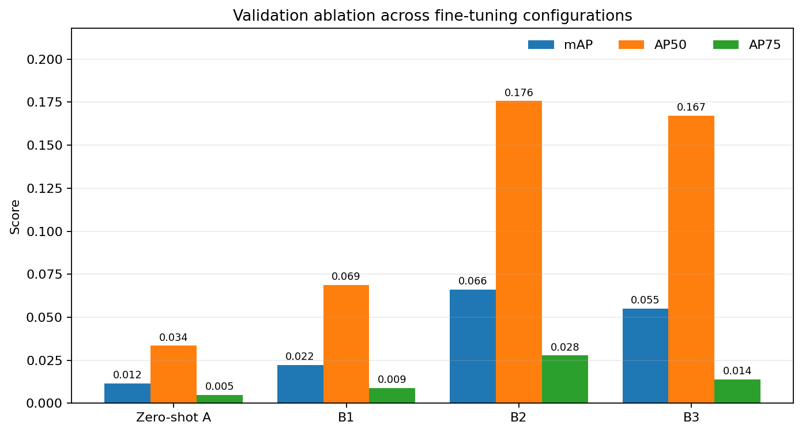
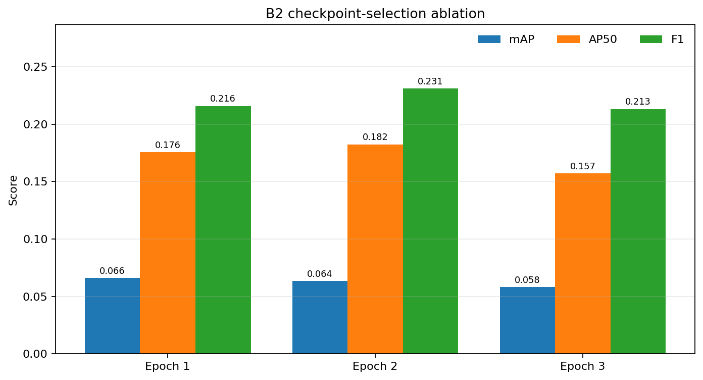
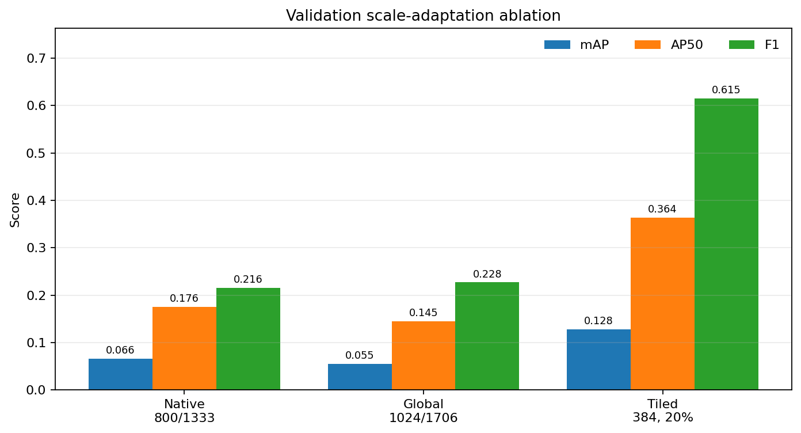
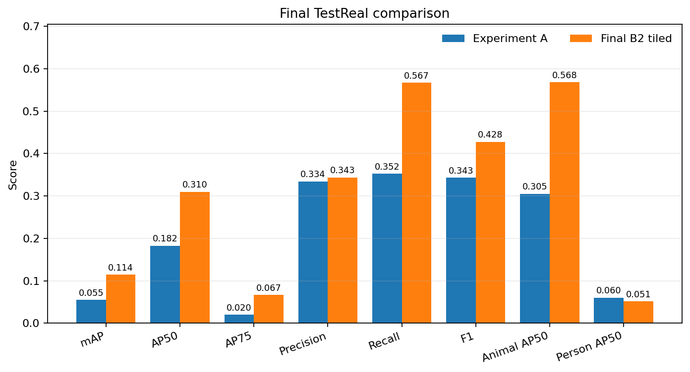

# Grounding DINO for BIRDSAI Thermal Imagery

This repository provides a reproducible pipeline for preparing the BIRDSAI thermal dataset, evaluating open-vocabulary object detection, fine-tuning Grounding DINO, and adapting inference to small thermal targets. The project studies the transfer of `IDEA-Research/grounding-dino-tiny` to two detection categories: `animal` and `person`.

The final system uses the B2 fine-tuning configuration at epoch 1 together with 384-pixel tiled inference, 20% tile overlap, and class-wise non-maximum suppression at IoU 0.50. On the official `TestReal` split, it improves COCO mAP from **5.49% to 11.44%** relative to the zero-shot baseline.

## Project status

- [x] Validate and prepare BIRDSAI annotations
- [x] Create leakage-safe sequence-level train and validation splits
- [x] Convert MOT annotations to COCO detection format
- [x] Establish a zero-shot Grounding DINO baseline
- [x] Fine-tune and compare B1, B2, and B3 configurations
- [x] Select checkpoints using validation mAP
- [x] Compare native, global high-resolution, and tiled inference
- [x] Freeze the final configuration and evaluate `TestReal` once
- [x] Produce quantitative and qualitative reports

## Research questions

1. How well does zero-shot Grounding DINO transfer to aerial thermal imagery?
2. Which parts of Grounding DINO should be adapted to the BIRDSAI domain?
3. Does scale-aware inference improve the detection of small thermal targets?

## Dataset

[BIRDSAI](https://lila.science/datasets/conservationdrones) is a long-wave thermal infrared dataset of animals and people recorded at night from aerial platforms in Southern Africa. Annotations use MOT-style CSV files with frame ID, object ID, bounding box, class, species, occlusion, and noise fields.

The raw dataset is not committed to this repository. Download it from the official BIRDSAI distribution and arrange it as follows:

```text
archive/
├── TrainReal/
│   ├── annotations/*.csv
│   └── images/<sequence_id>/*.{jpg,png}
└── TestReal/
    ├── annotations/*.csv
    └── images/<sequence_id>/*.{jpg,png}
```

### Prepared dataset summary

| Split | Images | Annotations | Empty images | Source |
|---|---:|---:|---:|---|
| Train | 33,926 | 72,113 | 15,799 | `TrainReal` |
| Validation | 6,735 | 15,086 | 3,653 | Sequence-level holdout from `TrainReal` |
| Test | 21,333 | 78,761 | 5,839 | Official `TestReal` |

All frames, including empty frames, are retained so that false positives per frame can be measured correctly. Complete sequences are assigned to a single split to prevent temporal leakage.

### Annotation mapping

| BIRDSAI class | COCO category ID | Detection category |
|---:|---:|---|
| 0 | 1 | `animal` |
| 1 | 2 | `person` |

Object IDs, species labels, occlusion flags, noise flags, sequence IDs, and frame IDs are retained as custom COCO fields.

## Repository layout

```text
birdsai_pipeline/             Python data, training, inference, and evaluation modules
configs/                      Experiment prompts and frozen configurations
scripts/                      Data-preparation entry points
slurm/                        Reproducible HPC job definitions
tests/                        Pipeline smoke tests
reports/                      Lightweight reports, metrics, and figures
README.md                     Project documentation
pyproject.toml                Python package and dependencies
```

Raw images, caches, full prediction files, and model checkpoints are intentionally stored outside Git.

## Installation

The experiments were run with Python 3.11, PyTorch 2.14.1 with CUDA 13.2, Torchvision 0.29.1, Transformers 5.22.2, SciPy, and pycocotools.

```bash
module load miniconda3
source "$(conda info --base)/etc/profile.d/conda.sh"

conda create -n birdsai-data python=3.11 -y
conda activate birdsai-data

cd ~/computer_vision/birdsai_data_pipeline
python -m pip install --upgrade pip
python -m pip install -e .

python -m pip install --no-cache-dir \
  torch==2.14.1 \
  torchvision==0.29.1 \
  --index-url https://download.pytorch.org/whl/cu132

python -m pip install --no-cache-dir \
  transformers==5.22.2 \
  safetensors
```

For later sessions:

```bash
module load miniconda3
source "$(conda info --base)/etc/profile.d/conda.sh"
conda activate birdsai-data
cd ~/computer_vision/birdsai_data_pipeline
```

## Data preparation and evaluation

Run the complete preparation pipeline:

```bash
bash scripts/run_data_pipeline.sh \
  "$HOME/computer_vision/archive" \
  "$HOME/computer_vision/outputs"
```

Predictions are evaluated in COCO result format using:

```bash
python -m birdsai_pipeline.evaluate \
  --ground-truth "$HOME/computer_vision/outputs/coco/validation.json" \
  --predictions /path/to/predictions.json \
  --score-threshold 0.10 \
  --iou-threshold 0.50 \
  --output /path/to/metrics.json
```

Reported metrics include COCO mAP, AP50, AP75, size-specific AP and AR, per-class AP, precision, recall, F1, false positives per frame, and subgroup recall.

## Experiment A: zero-shot baseline

Four prompt formulations were compared on validation. The final baseline used `person . animal .` with box threshold 0.10, text threshold 0.20, and operating score threshold 0.10. Ambiguous phrases matching both final categories were excluded.

| Split | mAP | AP50 | AP75 | Precision | Recall | F1 | FP/frame | Animal AP50 | Person AP50 |
|---|---:|---:|---:|---:|---:|---:|---:|---:|---:|
| Validation | 0.0116 | 0.0336 | 0.0049 | 0.1571 | 0.1285 | 0.1413 | 1.5440 | 0.0672 | 0.0000 |
| TestReal | 0.0549 | 0.1824 | 0.0197 | 0.3340 | 0.3522 | 0.3429 | 2.5926 | 0.3049 | 0.0600 |

## Experiment B: thermal-domain fine-tuning

All configurations retain the BERT text backbone and use the fixed training prompt `animal . person .`.

| Configuration | Trainable components | Trainable parameters | Share |
|---|---|---:|---:|
| B1 | Fusion encoder, decoder, and detection heads | 35,836,936 | 20.81% |
| B2 | B1 plus Swin-T stages 3 and 4 | 61,866,304 | 35.92% |
| B3 | B1 plus the complete Swin-T visual backbone | 63,358,978 | 36.78% |

### Configuration ablation

The first checkpoint from each configuration was evaluated on the same validation split. B2 achieved the highest validation mAP and was therefore selected for continued training.

| Model | mAP | AP50 | AP75 | Precision | Recall | F1 | Animal AP50 | Person AP50 |
|---|---:|---:|---:|---:|---:|---:|---:|---:|
| Experiment A | 0.0116 | 0.0336 | 0.0049 | 0.1571 | 0.1285 | 0.1413 | 0.0672 | 0.0000 |
| B1 epoch 1 | 0.0223 | 0.0689 | 0.0089 | 0.0837 | 0.4732 | 0.1422 | 0.1378 | 0.0000 |
| **B2 epoch 1** | **0.0661** | **0.1757** | **0.0279** | 0.1299 | 0.6382 | **0.2158** | **0.2762** | **0.0751** |
| B3 epoch 1 | 0.0551 | 0.1672 | 0.0139 | 0.1104 | 0.6478 | 0.1887 | 0.2751 | 0.0593 |



### B2 checkpoint-selection ablation

Although epoch 2 produced slightly higher AP50 and F1 at the fixed operating threshold, epoch 1 retained the best validation COCO mAP and was selected before test evaluation.

| B2 checkpoint | mAP | AP50 | AP75 | Precision | Recall | F1 | Animal AP50 | Person AP50 |
|---|---:|---:|---:|---:|---:|---:|---:|---:|
| **Epoch 1** | **0.0661** | 0.1757 | **0.0279** | 0.1299 | 0.6382 | 0.2158 | 0.2762 | 0.0751 |
| Epoch 2 | 0.0635 | **0.1824** | 0.0198 | 0.1407 | **0.6440** | **0.2310** | **0.2872** | **0.0776** |
| Epoch 3 | 0.0581 | 0.1571 | 0.0251 | 0.1297 | 0.6008 | 0.2133 | 0.2662 | 0.0480 |



## Scale adaptation

Three inference strategies were compared using the selected B2 epoch-1 checkpoint.

| Validation strategy | mAP | AP50 | AP75 | Precision | Recall | F1 | Animal AP50 | Person AP50 |
|---|---:|---:|---:|---:|---:|---:|---:|---:|
| Native 800/1333 | 0.0661 | 0.1757 | 0.0279 | 0.1299 | **0.6382** | 0.2158 | 0.2762 | 0.0751 |
| Global 1024/1706 | 0.0552 | 0.1450 | 0.0236 | 0.1429 | 0.5575 | 0.2275 | 0.2661 | 0.0240 |
| **Tiled 384, 20% overlap** | **0.1283** | **0.3640** | **0.0525** | **0.6571** | 0.5783 | **0.6152** | **0.5400** | **0.1881** |

Tiled inference applies class-wise NMS at IoU 0.50 after mapping tile predictions back to full-image coordinates. It improved validation mAP by 94.1% relative to native inference.



## Final frozen TestReal evaluation

The final configuration was selected entirely on validation and evaluated once on the official test split:

- Model: `IDEA-Research/grounding-dino-tiny`
- Fine-tuning: B2, epoch 1
- Prompt: `animal . person .`
- Tile size: 384 pixels
- Tile overlap: 20%
- Class-wise NMS IoU: 0.50
- Box threshold: 0.10
- Text threshold: 0.20
- Evaluation score threshold: 0.10

| Model | mAP | AP50 | AP75 | Precision | Recall | F1 | FP/frame | Animal AP50 | Person AP50 |
|---|---:|---:|---:|---:|---:|---:|---:|---:|---:|
| Experiment A TestReal | 0.0549 | 0.1824 | 0.0197 | 0.3340 | 0.3522 | 0.3429 | 2.5926 | 0.3049 | **0.0600** |
| **Final B2 tiled TestReal** | **0.1144** | **0.3096** | **0.0666** | **0.3434** | **0.5668** | **0.4277** | 4.0019 | **0.5681** | 0.0511 |

Relative to Experiment A, the final system improved mAP by **108.4%**, AP50 by **69.7%**, AP75 by **238.0%**, recall by **60.9%**, and F1 by **24.7%**. Animal AP50 improved by **86.3%**. Person AP50 decreased by **14.8%**, and false positives per frame increased by **54.4%**.



### Final class metrics at score 0.10

| Class | TP | FP | FN | Precision | Recall | F1 |
|---|---:|---:|---:|---:|---:|---:|
| Animal | 42,259 | 67,342 | 14,649 | 0.3856 | 0.7426 | 0.5076 |
| Person | 2,383 | 18,031 | 19,470 | 0.1167 | 0.1090 | 0.1128 |

## Interpretation

Fine-tuning and tiled inference substantially improve overall thermal-domain transfer, especially for animals and small targets. The improvement is not uniform across categories: person detection remains weak, and the final tiled system produces more false positives per frame on `TestReal`. The final model should therefore be treated as a research baseline rather than a deployment-ready wildlife-monitoring system.

## Reproducibility and artifacts

The repository tracks source code, experiment configurations, Slurm files, compact JSON metrics, figures, and reports. It does not track raw data, Hugging Face caches, full JSONL prediction streams, or model checkpoints.

Recommended external artifact locations:

| Artifact | Recommended location |
|---|---|
| BIRDSAI raw data | Official LILA Science distribution |
| Final B2 checkpoint | Hugging Face model repository or institutional object storage |
| Full predictions and training logs | Zenodo, OSF, or institutional object storage |
| Compact metrics, figures, and reports | This GitHub repository |

Record external artifact URLs and checksums in `ARTIFACTS.md` so a clone of this repository remains sufficient to locate every reproducibility asset.

## Limitations

- Person detection remains poor: final TestReal person AP50 is 0.0511 and person F1 is 0.1128.
- Tiled inference improves recall and animal detection but increases false positives and runtime.
- The validation and test splits differ in target size, object density, empty-frame frequency, and occlusion, which affects direct metric comparability.
- The study evaluates one Grounding DINO model size and one primary prompt during fine-tuning.
- Hyperparameter selection was constrained by HPC time and GPU availability.
- Thermal imagery from other sensors, altitudes, environments, and geographic regions was not evaluated.
- Results are not sufficient to justify autonomous operational or conservation decisions.

## Future work

- Increase person-focused sampling or apply class-balanced losses.
- Investigate focal-loss weighting and hard-negative mining to reduce person false positives.
- Train with multi-scale crops or tiled samples rather than applying tiling only at inference.
- Explore target-aware augmentation for low-contrast and very small objects.
- Compare additional Grounding DINO backbones and parameter-efficient adaptation methods.
- Calibrate separate per-class score thresholds using validation data.
- Measure inference speed and memory use for native and tiled deployment settings.
- Evaluate temporal aggregation and tracking across adjacent frames.
- Test cross-dataset generalization on additional aerial thermal datasets.

## Experimental discipline

Prompts, fine-tuning configurations, checkpoints, image scales, tile parameters, NMS, and score thresholds are selected using validation data only. `TestReal` is reserved for one final evaluation after the configuration is frozen. Further tuning must not use the reported test results.

## License

The original project code is intended for release under the [Apache License 2.0](LICENSE). Third-party components remain under their own licenses:

- BIRDSAI data: [Community Data License Agreement - Permissive](https://cdla.dev/permissive-2-0/). The dataset is not relicensed by this repository.
- Grounding DINO and the `IDEA-Research/grounding-dino-tiny` weights: Apache License 2.0.
- Reports and example images derived from BIRDSAI remain subject to the applicable dataset terms and attribution requirements.

## Acknowledgements

This project uses the BIRDSAI dataset created by Bondi and collaborators and the Grounding DINO model developed by IDEA Research. It also relies on PyTorch, Hugging Face Transformers, Torchvision, SciPy, pycocotools, and the HPC infrastructure used to run the experiments. We thank the BIRDSAI authors for releasing the thermal imagery and annotations and the Grounding DINO authors for releasing their model and implementation.

## References

- E. Bondi et al., "BIRDSAI: A Dataset for Detection and Tracking in Aerial Thermal Infrared Videos."
- S. Liu et al., "Grounding DINO: Marrying DINO with Grounded Pre-Training for Open-Set Object Detection," ECCV 2024.

When using this repository, please cite both the BIRDSAI dataset paper and the Grounding DINO paper.
