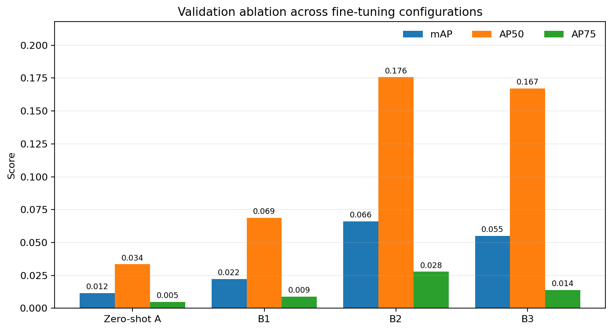
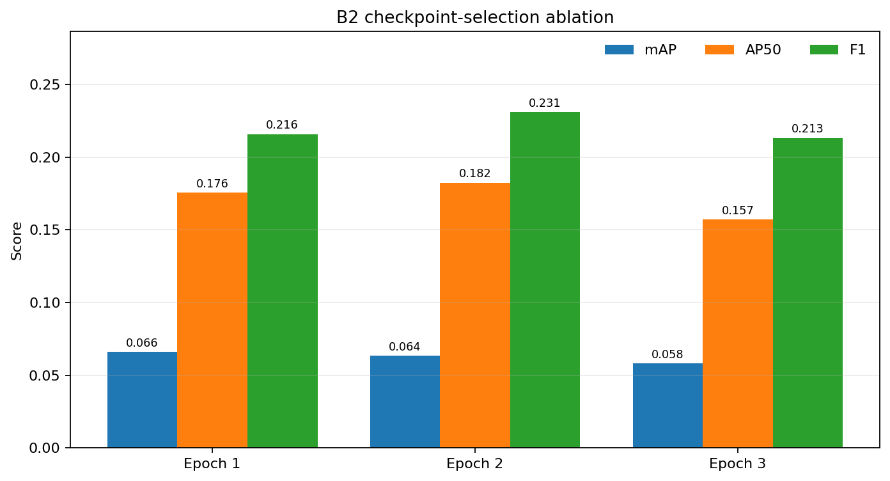
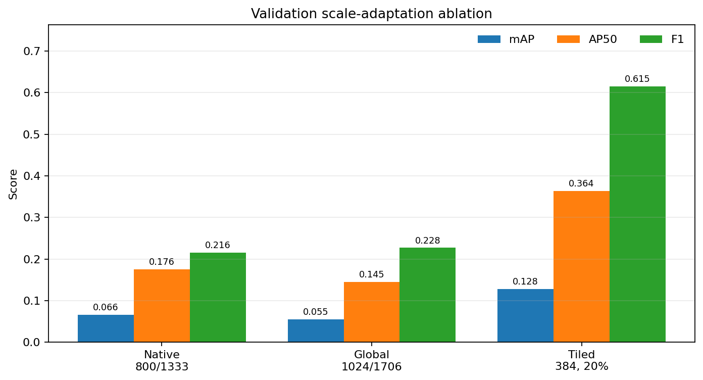
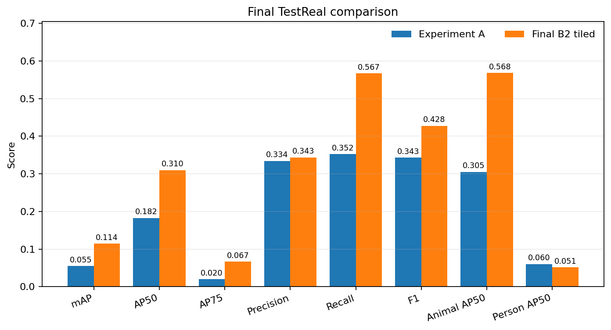

# Experiment results

All configuration, checkpoint, scale, and threshold choices were made on the
validation split. The official TestReal split was reserved for the frozen final
evaluation.

## Experiment A: zero-shot baseline

| Split | mAP | AP50 | AP75 | Precision | Recall | F1 | FP/frame | Animal AP50 | Person AP50 |
|---|---:|---:|---:|---:|---:|---:|---:|---:|---:|
| Validation | 0.0116 | 0.0336 | 0.0049 | 0.1571 | 0.1285 | 0.1413 | 1.5440 | 0.0672 | 0.0000 |
| TestReal | 0.0549 | 0.1824 | 0.0197 | 0.3340 | 0.3522 | 0.3429 | 2.5926 | 0.3049 | 0.0600 |

The selected prompt was person . animal ., with box threshold 0.10, text
threshold 0.20, and evaluation score threshold 0.10.

## Fine-tuning configuration ablation

| Model | Trainable visual components | mAP | AP50 | AP75 | F1 | Animal AP50 | Person AP50 |
|---|---|---:|---:|---:|---:|---:|---:|
| Experiment A | None | 0.0116 | 0.0336 | 0.0049 | 0.1413 | 0.0672 | 0.0000 |
| B1 epoch 1 | Visual backbone frozen | 0.0223 | 0.0689 | 0.0089 | 0.1422 | 0.1378 | 0.0000 |
| **B2 epoch 1** | **Swin-T stages 3–4** | **0.0661** | **0.1757** | **0.0279** | **0.2158** | **0.2762** | **0.0751** |
| B3 epoch 1 | Complete Swin-T backbone | 0.0551 | 0.1672 | 0.0139 | 0.1887 | 0.2751 | 0.0593 |

## B2 checkpoint ablation

| Checkpoint | mAP | AP50 | AP75 | Precision | Recall | F1 | Animal AP50 | Person AP50 |
|---|---:|---:|---:|---:|---:|---:|---:|---:|
| **Epoch 1** | **0.0661** | 0.1757 | **0.0279** | 0.1299 | 0.6382 | 0.2158 | 0.2762 | 0.0751 |
| Epoch 2 | 0.0635 | **0.1824** | 0.0198 | **0.1407** | **0.6440** | **0.2310** | **0.2872** | **0.0776** |
| Epoch 3 | 0.0581 | 0.1571 | 0.0251 | 0.1297 | 0.6008 | 0.2133 | 0.2662 | 0.0480 |

Epoch 1 was selected because COCO mAP was the predefined checkpoint-selection
metric.

## Scale adaptation

| Validation strategy | mAP | AP50 | AP75 | Precision | Recall | F1 | Animal AP50 | Person AP50 |
|---|---:|---:|---:|---:|---:|---:|---:|---:|
| Native 800/1333 | 0.0661 | 0.1757 | 0.0279 | 0.1299 | **0.6382** | 0.2158 | 0.2762 | 0.0751 |
| Global 1024/1706 | 0.0552 | 0.1450 | 0.0236 | 0.1429 | 0.5575 | 0.2275 | 0.2661 | 0.0240 |
| **Tiled 384, 20% overlap** | **0.1283** | **0.3640** | **0.0525** | **0.6571** | 0.5783 | **0.6152** | **0.5400** | **0.1881** |

## Frozen final TestReal evaluation

| Model | mAP | AP50 | AP75 | Precision | Recall | F1 | FP/frame | Animal AP50 | Person AP50 |
|---|---:|---:|---:|---:|---:|---:|---:|---:|---:|
| Experiment A | 0.0549 | 0.1824 | 0.0197 | 0.3340 | 0.3522 | 0.3429 | 2.5926 | 0.3049 | **0.0600** |
| **B2 epoch 1 + tiled** | **0.1144** | **0.3096** | **0.0666** | **0.3434** | **0.5668** | **0.4277** | 4.0019 | **0.5681** | 0.0511 |

### Final class metrics at score 0.10

| Class | TP | FP | FN | Precision | Recall | F1 |
|---|---:|---:|---:|---:|---:|---:|
| Animal | 42,259 | 67,342 | 14,649 | 0.3856 | 0.7426 | 0.5076 |
| Person | 2,383 | 18,031 | 19,470 | 0.1167 | 0.1090 | 0.1128 |

Fine-tuning and tiled inference improve overall transfer primarily through
animal detection. Person detection and the increased false-positive rate remain
the central limitations.
