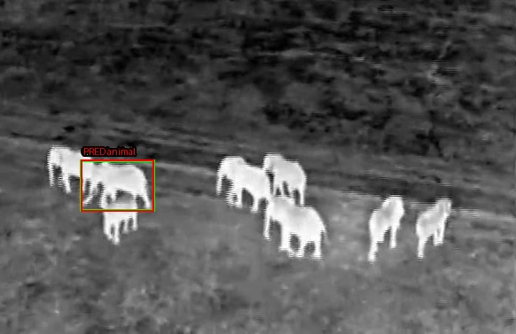
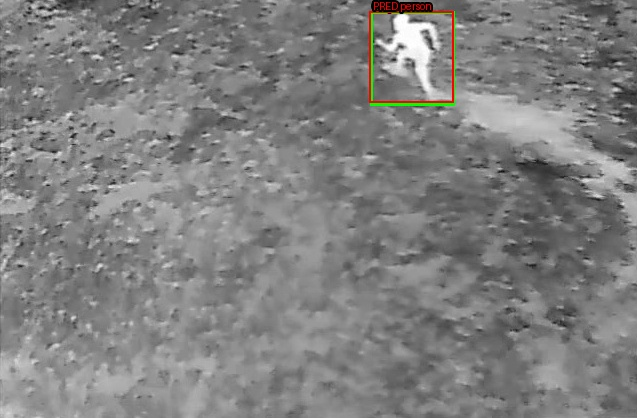
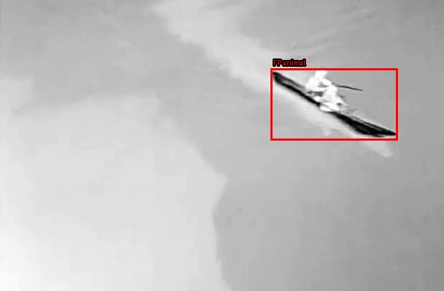
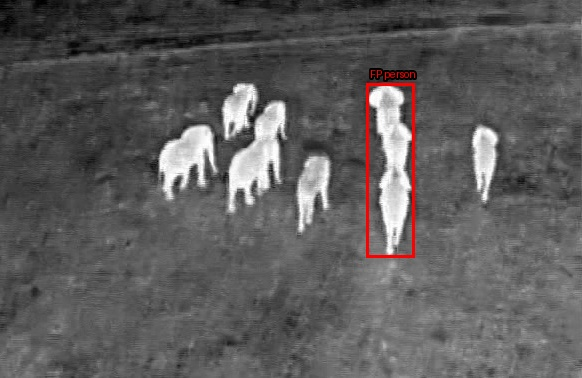
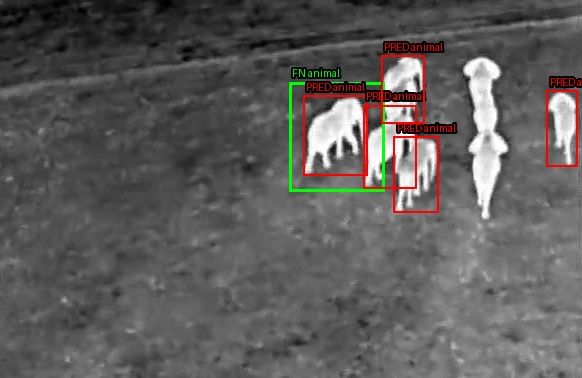
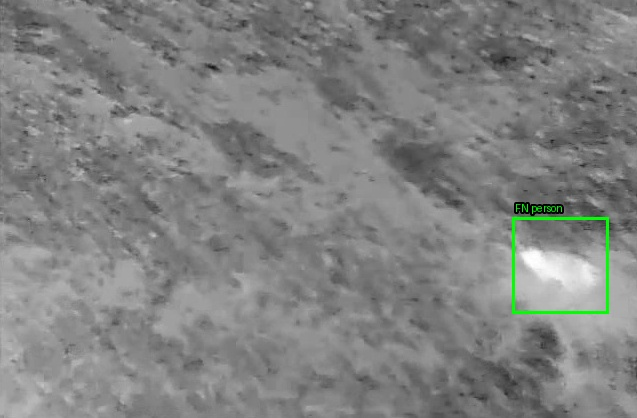

# Experiment A: Zero-shot Grounding DINO on BirdsAI Thermal Imagery

Generated: 2026-11-09T12:24:37.156308+00:00

## Research question

How well does pretrained zero-shot Grounding DINO transfer to BirdsAI thermal imagery without training or fine-tuning?

## Experimental setup

- Model: `IDEA-Research/grounding-dino-tiny`
- Execution backend: Hugging Face Transformers
- Custom CUDA/CPU kernels: disabled
- Final categories: `animal` and `person`
- Prompt selection: validation COCO mAP
- Threshold selection: validation F1 at IoU 0.50
- TestReal was evaluated once after freezing the configuration.

Selected configuration:

- Prompt: `person . animal .`
- Box threshold: `0.1`
- Text threshold: `0.2`
- Operating score threshold: `0.1`

Ambiguous phrases matching both person and animal were excluded.

## Dataset comparison

| Split | Sequences | Images | Annotations | Objects/image | Empty images | Animal median area | Person median area |
|---|---:|---:|---:|---:|---:|---:|---:|
| Validation | 6 | 6735 | 15086 | 2.24 | 54.2% | 294.0 | 300.0 |
| Test | 16 | 21333 | 78761 | 3.69 | 27.4% | 2952.0 | 522.0 |

TestReal contains substantially larger animals and fewer empty images than validation. This makes TestReal more favorable to zero-shot object detection and explains much of the performance gap.

## Validation prompt comparison

| Prompt | mAP | AP50 | AP75 | Precision@0.25 | Recall@0.25 | F1@0.25 | Animal AP50 | Person AP50 |
|---|---:|---:|---:|---:|---:|---:|---:|---:|
| `person_animal` | 1.16% | 3.36% | 0.49% | 23.20% | 8.36% | 12.29% | 6.72% | 0.00% |
| `human_animal` | 0.38% | 0.78% | 0.32% | 7.81% | 1.99% | 3.17% | 1.56% | 0.00% |
| `person_wildlife` | 0.75% | 2.26% | 0.40% | 15.67% | 10.71% | 12.72% | 4.53% | 0.00% |
| `person_species` | 0.66% | 1.17% | 0.64% | 38.95% | 1.23% | 2.38% | 2.34% | 0.00% |

`person_animal` achieved the highest validation COCO mAP and was therefore selected before examining TestReal performance.

## Final validation and test results

| Split | mAP | AP50 | AP75 | Precision | Recall | F1 | False positives/frame | Animal AP50 | Person AP50 |
|---|---:|---:|---:|---:|---:|---:|---:|---:|---:|
| Validation | 1.16% | 3.36% | 0.49% | 15.71% | 12.85% | 14.13% | 1.54 | 6.72% | 0.00% |
| Test | 5.49% | 18.24% | 1.97% | 33.40% | 35.22% | 34.29% | 2.59 | 30.49% | 6.00% |

## Test class results

| Category | TP | FP | FN | Precision | Recall | F1 | AP50 |
|---|---:|---:|---:|---:|---:|---:|---:|
| Animal | 23917 | 34951 | 32991 | 40.63% | 42.03% | 41.32% | 30.49% |
| Person | 3824 | 20357 | 18029 | 15.81% | 17.50% | 16.61% | 6.00% |

## Interpretation

- Animal detection transfers substantially better than person detection.
- Test animal AP50 is 30.49%, compared with person AP50 of 6.00%.
- Overall test F1 is 34.29%, but the model produces 2.59 false positives per frame.
- The large drop from AP50 to AP75 indicates poor bounding-box localization.
- The model provides useful zero-shot animal-detection signal, but is not sufficiently reliable for deployment.
- The validation–test performance gap demonstrates substantial distribution differences between the two splits.

## Representative examples

Green boxes show ground truth. Red boxes show model predictions.

### TP — Animal

### TP — Person

### FP — Animal

### FP — Person

### FN — Animal

### FN — Person

All 18 representative examples are stored in:

`representative_examples/`

## Limitations

- Only one pretrained Grounding DINO model size was evaluated.
- No thermal-domain fine-tuning or adaptation was performed.
- Validation contains only six sequences and is not fully representative of TestReal.
- Detection performance varies strongly with object size.
- Results do not yet include uncertainty intervals across sequences.

## Conclusion

Zero-shot Grounding DINO demonstrates partial but limited transfer to BirdsAI thermal imagery. It detects animals substantially better than people, while precise localization remains weak. The results support using Grounding DINO as a baseline or pseudo-labeling aid, but not as a deployment-ready detector without thermal-domain adaptation or fine-tuning.
